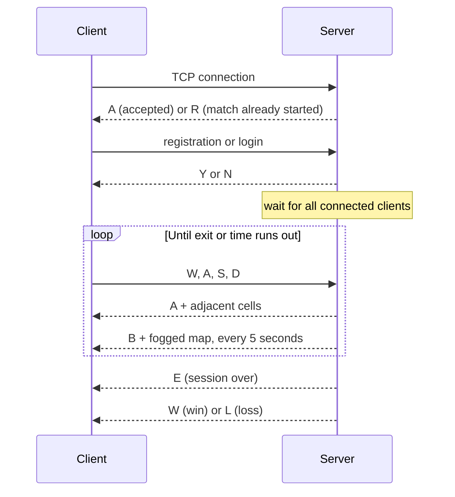

# LinuxMazeExplorer

A multiplayer terminal game with a client-server architecture, written in C for Linux.

Players enter the same server-generated maze and have limited time to collect items and find an exit. Each player sees only the cells around them and the ones they have already explored. Everything else is hidden by fog.

The game interface is in Italian:

```text
=================================
  MAPPA AGGIORNATA (blurrata)
=================================
  +-----------------------------+
  |?????????????????????????????|
  |?????????????????????????????|
  |????????###??????????????????|
  |????????  #??????????????????|
  |????????# #??????????????????|
  |????????# #??????????????????|
  |???????## #??????????????????|
  |??????? X  ??????????????????|
  |??????? ###??????????????????|
  |?????????????????????????????|
  |?????????????????????????????|
  +-----------------------------+
  Legenda: X=tu  +=item  ?=nebbia  #=muro

  Comando [W/A/S/D] | list | exit >
```

`X` is the player, `+` an item, `?` fog and `#` a wall.

## Tech stack

- **C** and **POSIX threads** for handling players concurrently
- **TCP sockets** with a custom application protocol
- **Mutexes and condition variables** for shared state
- **`fork`, `exec` and pipes** for computing the winner
- **Docker** and **Docker Compose** for deployment

## How to play

1. Each player connects, then registers or logs in.
2. The match starts once all connected clients have logged in. Later connections are refused.
3. Each player spawns in a random cell of the maze and has 40 seconds.
4. After each move, the client shows the adjacent cells. Every 5 seconds it receives the full map, with fog over unexplored cells.
5. Items (`+`) are shared: the first player to step on one collects it.
6. A player leaves the maze by moving past the edge of the map through one of the four openings.

Players who found an exit rank above those who did not. Among players with the same exit result, the one with the most items wins. The server shuts down when the match ends.

| Command | Effect |
| --- | --- |
| `W` `A` `S` `D` | Move up, left, down, right (uppercase only) |
| `list` | Show the players in the match |
| `exit` | Leave the match |

## Getting started

Linux is required. The server listens on port 8080.

### With gcc

```bash
gcc -Wall server.c map.c -o server -lpthread
gcc -Wall client.c map.c -o client -lpthread

./server                     # in one terminal
./client 127.0.0.1 8080      # in one terminal per player
```

### With Docker

```bash
touch users.txt score.txt filelog.txt   # files mounted into the container
docker compose up --build
```

Compose starts only the server. Build the client with gcc as shown above, or with Docker:

```bash
docker build -f Dockerfile.client -t lme-client .
docker run -it --rm --network host lme-client ./client 127.0.0.1 8080
```

Open all the clients before anyone logs in: the match starts as soon as every connected client has logged in.

## Architecture



### Server

The main thread uses `select()` to accept connections. It creates two threads for each client:

- `newUser` handles authentication, the lobby, the game loop and session shutdown
- `asyncSendBlurredMap` periodically sends the fogged map

When the last player enters the lobby, a `timer` thread starts and signals the end of the match.

| Primitive | Protects |
| --- | --- |
| `mutex` | Shared map during moves and item collection |
| `lobbyMutex`, `lobbyCond` | Lobby counters and the simultaneous match start |
| `timerMutex` | Time-up flag |
| `scoreMutex`, `scoreCond` | Writes to `score.txt` |
| `gWinnerMutex`, `gWinnerCond` | Player threads waiting for the winner |
| `listMutex` | List of connected players |
| `logMutex` | Lines in `filelog.txt` |
| `endMutex` | Server shutdown flag |
| `socketWriteMutex` | Sends on a client's socket, one per player |

The last thread to finish computes the winner: a child process runs a `sort | head | awk` pipeline on `score.txt` and returns the result to the parent through a pipe.

### Client

The main thread reads keyboard commands and receives the response to each move. A second thread polls the socket without blocking, using `MSG_PEEK | MSG_DONTWAIT`, and handles unsolicited messages: the fogged map, reaching an exit and the final result. `socketMutex` stops the two threads from reading the socket at the same time.

### Maze generation

`generateMap` starts from a grid of walls and carves corridors with a recursive DFS, moving two cells at a time in random order (Fisher-Yates shuffle). Each visited cell has a one-in-three chance of holding an item. `addExits` then opens one exit on each of the four sides.

## Configuration

| Parameter | File | Value |
| --- | --- | --- |
| `TIMER`: match length in seconds | `server.c` | 40 |
| `SECONDS_TO_BLUR`: fogged map interval in seconds | `server.c` | 5 |
| `MINWIDTHMAP`, `MAXWIDTHMAP`: maze width | `map.h` | 3 |
| `MINHEIGHTMAP`, `MAXHEIGHTMAP`: maze height | `map.h` | 3 |

The example at the top of this page was generated with a larger map: width 21-31 and height 11-15.

## Generated files

| File | Contents |
| --- | --- |
| `users.txt` | Registered accounts, in `username;password` format |
| `score.txt` | Match results, reset on each start |
| `filelog.txt` | Event log, reset on each start |

## Known limitations

- Passwords are stored in plain text and login only checks the username: the account system is not meant for real use.
- The server runs a single match per execution.

## Authors

-Rocco Molinari
-Daniele Megna
